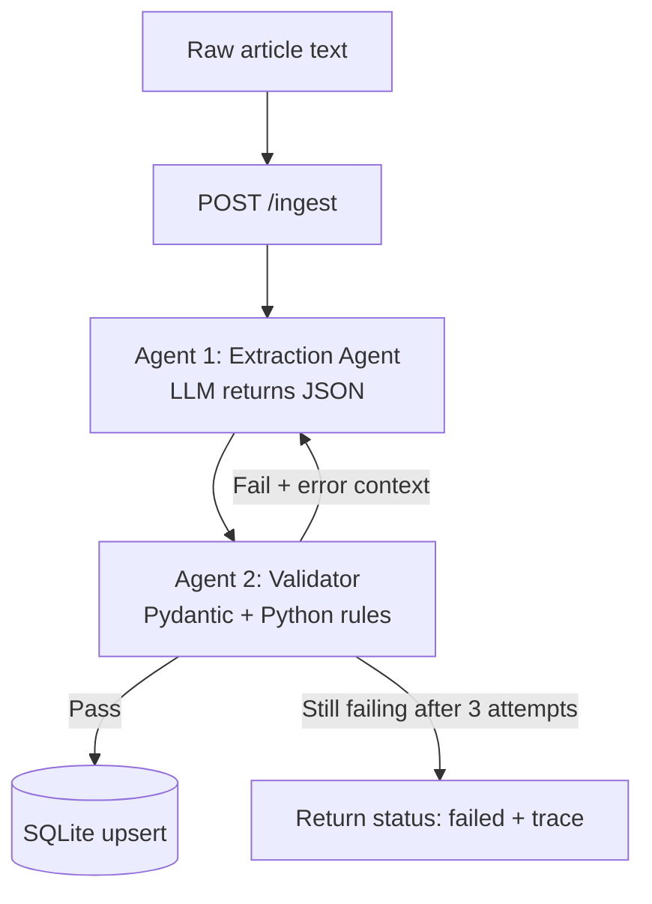

# Autonomous Competitor Intel Pipeline

Turns messy, unstructured text (press releases, news articles, web scrapes) into clean, validated rows in a SQL database, using a two-agent **Extract & Verify** loop that self-corrects when the LLM makes a mistake.

Built with **FastAPI**, **SQLite**, **Pydantic**, and any **OpenAI-compatible LLM API** (works with a free Gemini key, Groq, or a local Ollama model).

---

## The problem

Market research teams spend hours copying figures like revenue, hiring trends and product launches from articles into spreadsheets. LLMs can automate this, but they sometimes put the wrong thing in the wrong field (for example `"up by 20%"` in a revenue column) or invent a company name. Bad data in a production database is worse than no data.

This project solves that with a **programmatic self-correction loop**: nothing reaches the database until it passes validation.

## How it works



1. **Agent 1 (Extractor)** reads the article and returns JSON with `company_name`, `reported_revenue`, `revenue_currency`, `headcount_growth_percentage` and `key_product_launch`.
2. **Agent 2 (Validator)** checks the JSON with deterministic rules:
   - types are correct (revenue must be a number)
   - currency is a valid ISO 4217 code
   - revenue is positive and has a currency
   - headcount growth is in a plausible range
   - the company name actually appears in the source text (hallucination guard)
3. **If validation fails**, the exact error messages are sent back to Agent 1, which fixes only the offending fields. This repeats up to 3 times.
4. **If validation passes**, the record is upserted into SQLite. A normalized `company_key` with a `UNIQUE` constraint prevents duplicates (`Acme Corp`, `ACME Corp.` and `acme corp` are the same company).

Every response includes a `trace` of each attempt, so you can see the self-correction happen.

## Quickstart

**Prerequisites:** Python 3.10+ and a free LLM API key (see step 3).

### 1. Clone and enter the project

```bash
git clone https://github.com/<your-username>/competitor-intel.git
cd competitor-intel
```

### 2. Create a virtual environment and install dependencies

**Windows (PowerShell):**
```powershell
python -m venv venv
venv\Scripts\Activate.ps1
pip install -r requirements.txt
```
If activation is blocked, run `Set-ExecutionPolicy -Scope CurrentUser -ExecutionPolicy RemoteSigned` once and try again.

**macOS / Linux:**
```bash
python -m venv venv
source venv/bin/activate
pip install -r requirements.txt
```

### 3. Configure your LLM

Copy the example environment file and fill it in:

**Windows:** `copy .env.example .env`
**macOS / Linux:** `cp .env.example .env`

Then edit `.env`:

```
LLM_API_KEY=your_key_here
LLM_BASE_URL=https://generativelanguage.googleapis.com/v1beta/openai/
LLM_MODEL=your-model-name
```

Any OpenAI-compatible provider works:

| Provider | Cost | `LLM_BASE_URL` |
|---|---|---|
| Google Gemini (key from AI Studio) | Free tier | `https://generativelanguage.googleapis.com/v1beta/openai/` |
| Groq | Free tier | `https://api.groq.com/openai/v1` |
| Ollama (local) | Free | `http://localhost:11434/v1` (use any dummy key) |

Model names change often. To see what your key can use, run:

```bash
python list_models.py
```

and put a current flash-style text model in `LLM_MODEL`. Do not wrap values in quotes, and restart the server after editing `.env`.

### 4. Run the server

From the project root:

```bash
uvicorn app.main:app --reload
```

### 5. Try it

Open **http://127.0.0.1:8000/docs** (interactive Swagger UI), expand `POST /ingest`, click **Try it out**, paste the body below and click **Execute**:

```json
{
  "text": "Acme Corp reported annual revenue of $4.2 billion, while headcount grew 18% year over year. The company also launched its AI analytics suite, Insight Pro."
}
```

Then open `GET /insights` to see the stored record.

Or from a terminal:

**macOS / Linux:**
```bash
curl -X POST http://127.0.0.1:8000/ingest \
  -H "Content-Type: application/json" \
  -d '{"text":"Acme Corp reported annual revenue of $4.2 billion, while headcount grew 18% year over year. The company also launched its AI analytics suite, Insight Pro."}'
```

**Windows PowerShell:**
```powershell
Invoke-RestMethod -Method Post -Uri http://127.0.0.1:8000/ingest `
  -ContentType "application/json" `
  -Body '{"text":"Acme Corp reported annual revenue of $4.2 billion, while headcount grew 18% year over year. The company also launched its AI analytics suite, Insight Pro."}'
```

## API

| Method | Endpoint | Description |
|---|---|---|
| `POST` | `/ingest` | Takes `{"text": "..."}`, runs the extract and verify loop, upserts on success |
| `GET` | `/insights` | Lists all stored competitor records |
| `GET` | `/docs` | Interactive API documentation |

### Example response

```json
{
  "status": "success",
  "action": "created",
  "data": {
    "company_name": "Acme Corp",
    "reported_revenue": 4200000000.0,
    "revenue_currency": "USD",
    "headcount_growth_percentage": 18.0,
    "key_product_launch": "Insight Pro"
  },
  "trace": [
    { "attempt": 1, "output": { "...": "..." }, "errors": [] }
  ]
}
```

`action` is `created` for a new company and `updated` when the company already exists.

### Example of self-correction

If attempt 1 produces a bad currency, the trace shows the loop fixing it:

```json
"trace": [
  { "attempt": 1, "output": { "revenue_currency": "DOLLARS" },
    "errors": ["revenue_currency 'DOLLARS' is not a valid ISO 4217 code."] },
  { "attempt": 2, "output": { "revenue_currency": "USD" }, "errors": [] }
]
```

If it still fails after 3 attempts, the API returns `"status": "failed"` with the full trace and writes nothing to the database.

<!-- Add screenshots here, for example: -->
<!--  -->
<!--  -->

## Running the tests

The tests need no API key or internet connection. The loop tests replace the LLM with a fake extractor.

```bash
python -m pytest -v
```

They cover validation rules (bad types, invalid currency, negative revenue, hallucinated company names, implausible growth) and the loop itself (self-correction on the second attempt, giving up after the maximum attempts).

## Project structure

```
competitor-intel/
├── app/
│   ├── main.py        # FastAPI endpoints
│   ├── db.py          # SQLite schema and safe upsert
│   ├── schemas.py     # Pydantic model for extracted data
│   ├── extractor.py   # Agent 1: LLM extraction
│   ├── validator.py   # Agent 2: validation rules
│   └── pipeline.py    # The extract, validate, retry loop
├── tests/
│   ├── test_validator.py
│   └── test_pipeline.py
├── list_models.py     # Helper: list models available to your API key
├── requirements.txt
├── .env.example
└── README.md
```

## Design decisions

- **Deterministic validation.** The validator is plain Python, not another LLM call, so checks are free, fast, repeatable and unit-testable. An LLM can reason about text, but it should not be the only gatekeeper for data quality.
- **Error context in the retry.** Agent 1 receives its previous output plus the exact validation errors, so it fixes specific fields instead of starting over.
- **Bounded loop.** A hard cap of 3 attempts prevents runaway cost and infinite loops, and failures are reported rather than hidden.
- **Database-level dedupe.** A normalized `company_key` with a `UNIQUE` constraint and `ON CONFLICT DO UPDATE` makes duplicates impossible even if application logic has a bug.
- **Parameterized SQL.** All queries use `?` placeholders, never string formatting, to prevent SQL injection.
- **Provider-agnostic.** The OpenAI-compatible client means switching LLM providers is a `.env` change, with no code changes.

## Limitations and next steps

- Extracts one company per article; multi-company articles are not split yet.
- The ISO currency list is a short allowlist, not the full ISO 4217 set.
- Revenue is stored in its original currency; a `revenue_usd` column using a free exchange-rate API would allow comparisons.
- Only the latest values per company are stored; an audit table of every attempt would give history and a dashboard.
- Next ideas: an optional LLM reviewer that checks each value against the source text, a hand-labeled evaluation set with an accuracy score, and Docker packaging.

## License

MIT